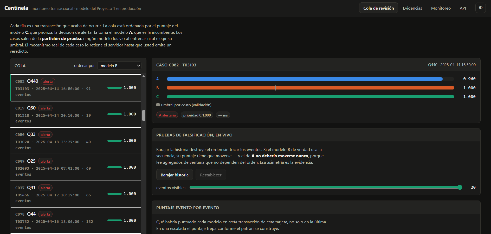
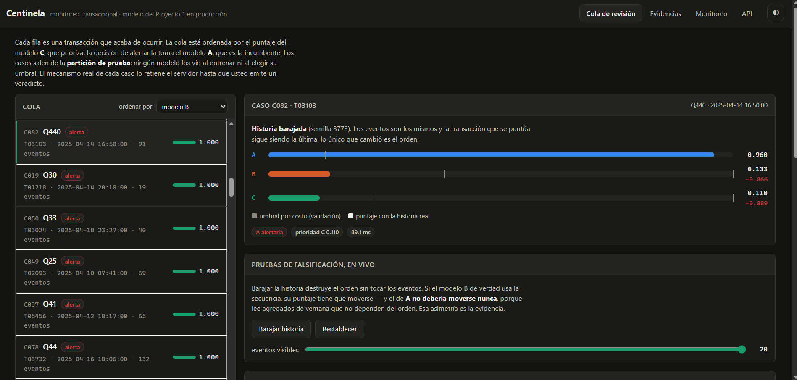
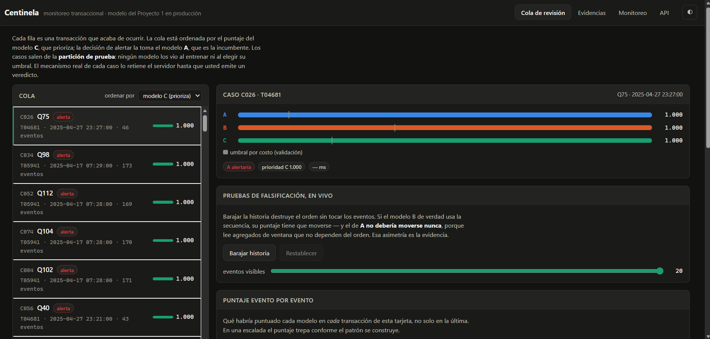
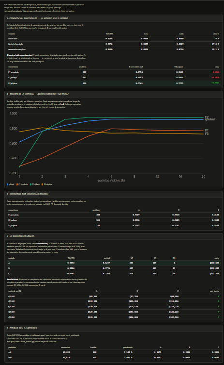
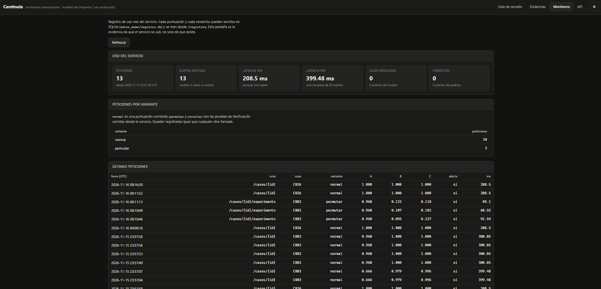
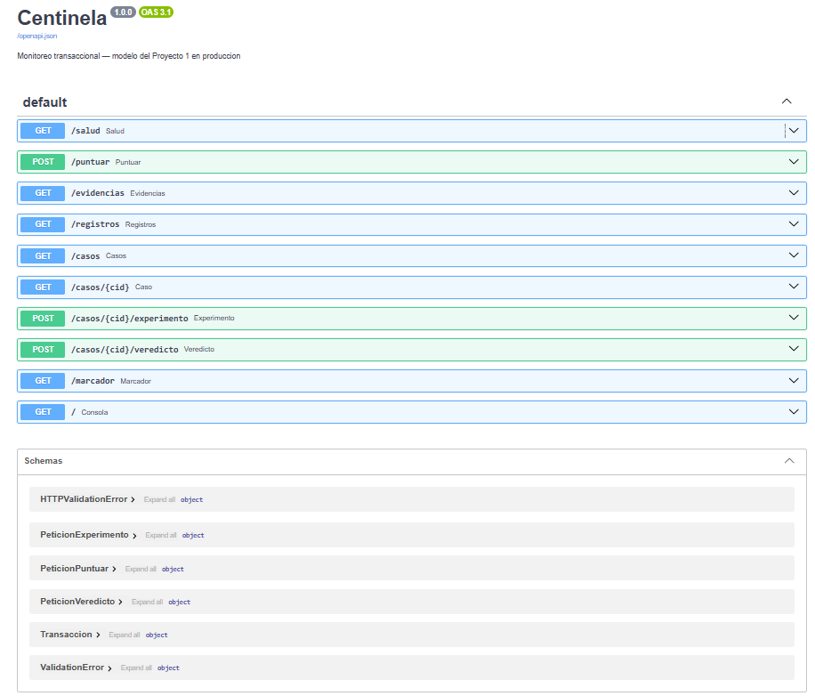

# Centinela — un modelo de Deep Learning en producción

**Universidad del Valle · Deep Learning y Sistemas Inteligentes 2026 · Kevin Recinos**

**Cindy Gualim** (21226) · **Gadiel Ocaña** (231270) · Entrega: 15 de noviembre de 2026

> **Servicio en vivo:** <https://deeplearning-p1.onrender.com> · API en
> [`/docs`](https://deeplearning-p1.onrender.com/docs) · ficha en
> [`/salud`](https://deeplearning-p1.onrender.com/salud) — instancia gratuita: si estuvo inactiva,
> la primera petición tarda ~1 min en despertarla.
> **Local:** `uvicorn api.app:app` → <http://127.0.0.1:8000> · API en `/docs`

Modelo base: el **Proyecto 1** de este mismo equipo
([informe](informe_Gualim_Ocana.pdf) · [README original](README_proyecto1.md) ·
[notebook](proyecto1_Gualim_Ocaña.ipynb)). No se reentrenó: se puso a servir.

---

## Resumen en una página

El Proyecto 1 terminó con tres modelos de detección de fraude transaccional, un hallazgo
incómodo y una recomendación. El hallazgo: **el orden de las transacciones aporta información
real —barajarlo le cuesta al modelo secuencial el 28 % de su AUC-PR— pero esa información
todavía no se paga sola**: en prueba, los intervalos de confianza del costo en quetzales cruzan
el cero. La recomendación fue *complementar, no reemplazar*.

Este proyecto convierte esa recomendación en software. **Centinela** es una consola de
monitoreo transaccional montada sobre una API pública, donde:

- el modelo **A** (agregadas, ciego al orden) **decide** si se alerta — es la incumbente y la
  más barata en prueba;
- el modelo **C** (híbrido) **prioriza** la cola de revisión manual — tiene el mejor AUC-PR en
  las dos particiones;
- el comité puede **barajar la historia de un caso en vivo** y ver desplomarse al modelo
  secuencial mientras el modelo A no se mueve **ni un diezmilésimo**.

Esa asimetría es la evidencia central del Proyecto 1, y aquí se puede tocar en lugar de leerla.

| | |
|---|---|
| Paridad con el notebook | **6/6 AUC-PR** coinciden al 4.º decimal; el build falla si se rompen |
| Latencia de puntuar una tarjeta | **39 ms** (p50) · 44 ms (p95) en local · 84–174 ms en Render (0.1 CPU) |
| Arranque del servicio | 6.4 s en local · 34.4 s en Render |
| Pruebas | **51**, todas en verde |
| Registro de uso | 203 peticiones en local ([volcado](datos_demo/registro_uso.jsonl)) · 13 en Render ([volcado](datos_demo/registro_render.json)) |

---

## 1. Problemática

**El problema.** Un banco guatemalteco con 1.4 millones de tarjetas necesita decidir, en el
momento en que una transacción ocurre, si la escala a revisión manual. El motor actual mira
**variables agregadas de ventana** —monto promedio de 24 h, transacciones por hora, monto máximo
del día, diversidad de comercios— y nunca mira el *orden* en que las transacciones ocurrieron.

Hay un patrón de fraude que ese motor no puede ver por construcción: la **escalada**. El
defraudador hace varias compras pequeñas de prueba, en montos crecientes, y enseguida el golpe
grande. Los mismos montos en otro orden son una sesión de compras legítima. Para un modelo que
solo ve promedios y máximos, los dos casos son **el mismo vector**.

**El usuario.** El equipo de monitoreo transaccional del área de riesgos. No es un modelo que
corra solo: es un analista con una cola de casos y tiempo finito para revisarlos.

**La decisión que depende del modelo.** En esta etapa, **priorizar la cola de revisión manual**
— no bloquear de forma autónoma. La diferencia importa: un falso positivo cuesta Q180 (una
llamada y la molestia del tarjetahabiente) y un falso negativo cuesta Q4,200 (el fraude
consumado). Con esa asimetría, el modelo no decide si alguien pierde su dinero; decide a quién
mira primero una persona.

**Por qué eso basta para estar en producción.** La consola *es* el puesto de trabajo: la cola
llega ordenada, el analista abre un caso, ve la historia completa de la tarjeta, puede correr las
pruebas de falsificación sobre ese caso concreto, y escala o descarta. El servicio registra cada
paso.

---

## 2. Planificación

El detalle —etapas, fechas, responsables, ruta crítica, riesgos y reparto de la presentación—
está en **[PLAN_FINAL.md](PLAN_FINAL.md)**. Resumen:

| Etapa | Fecha | Responsable |
|---|---|---|
| Decisión de alcance y diseño del producto | mar 3 nov | ambos |
| Extracción del pipeline del notebook a `src/` | mié 4 nov | Cindy |
| Puntuador de una tarjeta y contrato de entrada | mié 4 – jue 5 nov | Cindy |
| **Prueba de paridad con el notebook** | jue 5 nov | ambos |
| Banco de casos y evidencias precalculadas | jue 5 nov | Gadiel |
| API HTTP y registro de uso | vie 6 nov | Gadiel |
| Consola: cola, caso, experimentos en vivo | vie 6 – sáb 7 nov | Cindy |
| Pestañas de evidencias y monitoreo | sáb 7 nov | Gadiel |
| Pruebas de contrato y de API | sáb 7 nov | ambos |
| Empaque, despliegue y documentación | dom 8 nov | ambos |

La etapa de paridad gobernó la ruta crítica, y fue donde apareció el único defecto real del
proyecto: un supuesto de resolución de `datetime64` que rompía todas las variables de ventana.
Está contado completo en el plan, porque explica por qué esa prueba existe.

---

## 3. Supuestos

### Sobre los datos

1. **Son sintéticos, y eso no es un detalle menor.** Los tres mecanismos de fraude son los que
   nosotros diseñamos. Lo que está validado es la **metodología**; el comportamiento del fraude
   real, no.
2. **La prevalencia (1.2 % por transacción) está muy por encima de la real.** Las cifras en
   quetzales que produce el servicio son internamente consistentes pero **no trasladables**:
   léanse diferencias relativas, no montos.
3. **El historial de la tarjeta ya existe al puntuar.** El servicio recibe la historia completa
   y puntúa la última transacción. No es fuga: en producción, cuando una transacción llega, lo
   anterior ya ocurrió. La fuga sería usar información *posterior*.
4. **El generador asigna episodios uniformemente entre tarjetas**, lo que produce más fraude por
   transacción en tarjetas poco activas (2.9 % contra 0.6 %). El efecto medido sobre el AUC-PR es
   de 0.0003, pero existe.

### Sobre el usuario

5. **El analista revisa, no ejecuta.** El puntaje ordena su cola; la decisión de bloquear sigue
   siendo humana. Si eso cambiara, el umbral tendría que reelegirse con otra matriz de costos.
6. **Puede leer una secuencia.** La consola muestra la historia completa, no solo el puntaje,
   porque priorizar sin contexto no es revisar.
7. **El costo de un falso negativo es Q4,200 y el de un falso positivo Q180.** Son los supuestos
   del Proyecto 1. El servicio publica la sensibilidad a ese número precisamente porque la
   recomendación cambia si el banco lo corrige: **con FN a Q1,500 o Q2,500 conviene B, no A**.

### Sobre el entorno

8. **Arranque en frío:** una tarjeta con menos de 3 transacciones previas **no se puntúa**. La
   API devuelve 422 con un mensaje explícito. En producción esas tarjetas van a un camino de
   reglas.
9. **CPU, un proceso.** Puntuar una tarjeta toma ~39 ms; no hace falta GPU ni lotes.
10. **El modelo no se reentrena en línea.** Los pesos son los del Proyecto 1, versionados en
    `artefactos/`. Cualquier cambio pasa por el notebook y por la prueba de paridad.

---

## 4. Modelo planteado

### Proyecto de origen

[Proyecto 1 — *Monitoreo transaccional: detectar lo que el orden revela*](README_proyecto1.md).
Tres modelos entrenados sobre las mismas secuencias, la misma partición temporal y el mismo
horizonte:

| | Entrada | ¿Ve el orden? | AUC-PR val | AUC-PR test | Umbral |
|---|---|---|---|---|---|
| **A** `HistGradientBoosting` | 20 agregadas de ventana | **no** | 0.9171 | 0.9092 | 0.1217 |
| **B** GRU-128 + embeddings | 20 eventos ordenados | sí | 0.9226 | 0.9206 | 0.3776 |
| **C** híbrido GRU-128 + 18 agregadas | ambas | sí | **0.9424** | **0.9361** | 0.2263 |

### Arquitectura de C (el candidato)

```
eventos (20 × 6 numéricos)  ─┐
canal   (20) → embedding 3  ─┼─→ GRU(128), 1 capa ─→ estado final (128) ─┐
categoría (20) → embedding 4─┘                                            ├─→ Linear(192→64)
                                                                          │    ReLU, Dropout 0.2
agregadas causales (18, estandarizadas) ──────────────────────────────────┘    Linear(64→1)
                                                                               → sigmoide
```

### Cambios respecto del Proyecto 1, y su justificación

**Ninguno en los pesos.** El encargo permite mejorar el modelo pero no lo pide, y los pesos del
Proyecto 1 ya están defendidos con evidencia publicada. Reentrenar en seis días habría obligado
a rehacer toda la validación y habría puesto en riesgo lo que de verdad se califica aquí: que el
modelo quede usable por alguien ajeno al equipo.

Lo que sí cambió es **cómo se ejecuta**:

| Cambio | Por qué |
|---|---|
| El pipeline salió del notebook a `src/` | Un notebook de 113 celdas no se puede importar. `src/` es el mismo código, sin cambios de lógica, en módulos que la API importa. |
| Se agregó una **ruta por tarjeta** (`Puntuador.puntuar`) | El notebook puntúa matrices porque evalúa particiones; un servicio recibe una tarjeta a la vez. Las dos rutas comparten caracteristicas y artefactos, y `test_la_ruta_por_tarjeta_coincide_con_la_ruta_por_lote` verifica que dan el mismo número. |
| Se **arregló** el cálculo del minuto en las agregadas | El notebook asumía resolución de nanosegundos; con `datetime64[us]` las ventanas quedaban 1000× más anchas. El arreglo es resolución-independiente y está comentado en `src/caracteristicas.py`. **Sin él, A caía de 0.9171 a 0.7728.** |
| Se expuso una **política**, no un modelo | Servir solo C contradiría la recomendación del informe. `decidir()` implementa *A decide, C prioriza*. |

### La política servida

```python
alertar   = puntaje_A >= 0.1217      # la incumbente conserva la decisión
prioridad = puntaje_C                # el híbrido ordena la cola
```

**Por qué A decide y no C.** C tiene el mejor AUC-PR en ambas particiones, pero en prueba fue el
**más caro** (Q131,220 contra Q110,820 de A). Esa diferencia son 7 fraudes sobre 644 y no es
estadísticamente distinguible del ruido — pero tampoco hay evidencia de que C sea más barato. Ante
el empate, la incumbente conserva la decisión y el retador se gana la cola. Es la lectura
conservadora, y es revisable: el servicio publica la tabla de sensibilidad que la invertiría.

---

## 5. Validación de hipótesis

### 5.1 La hipótesis del Proyecto 1 (declarada antes de entrenar)

> *El orden de las transacciones aporta información que las variables agregadas no capturan.*

**Métrica:** AUC-PR. **Criterio de éxito declarado antes de ver prueba:** que barajar el orden
dentro de cada secuencia degrade al modelo secuencial, y que **no** degrade el mecanismo F3,
diseñado sin dependencia del orden. **Línea base:** el modelo A sobre las mismas secuencias.

### 5.2 Resultado — prueba de permutación (recalculada por este servicio sobre prueba)

| variante | AUC-PR | desv. | caída |
|---|---|---|---|
| orden real | 0.9206 | — | — |
| historia barajada | 0.6676 | 0.0037 | **−0.2529 (27.5 %)** |
| secuencia completa barajada | 0.0450 | 0.0026 | −0.8756 (95.1 %) |

**El control, que es lo que hace válida la prueba:**

| mecanismo | B con orden real | B barajado | caída |
|---|---|---|---|
| F1_escalada (depende del orden) | 0.7710 | 0.3149 | **−0.4561** |
| F2_ráfaga (semi-orden) | 0.9483 | 0.4634 | −0.4849 |
| **F3_atípico (NO depende del orden)** | 0.7261 | 0.7773 | **+0.0512** |

F3 es el único que no se degrada. Eso descarta que la caída venga de un error de código: un bug
habría hundido a los tres por igual.

### 5.3 La hipótesis propia de este proyecto

> *Si el modelo A es realmente ciego al orden, barajar la historia no puede mover su puntaje
> **en absoluto** — no «poco», sino exactamente cero.*

**Criterio declarado antes de medir:** desvío máximo de A sobre los 85 casos de la cola, con
permutación, **< 1e-9**.

**Resultado, medido sobre el servicio corriendo, vía HTTP, en los 85 casos:**

```
movimiento máximo de A : 0.00e+00      (criterio: < 1e-9)   CUMPLE
caída media de B       : +0.1107
caída máxima de B      : +0.9589       (caso C082: 1.000 → 0.041)
```

Es exactamente cero, no aproximadamente cero, y eso tiene una razón estructural: las agregadas se
calculan sobre ventanas de tiempo reales de la historia de la tarjeta, no sobre la ventana de
secuencia. Barajar el vector de entrada de la GRU no toca ni una de las 20 columnas de A.
`test_el_modelo_a_es_ciego_al_orden` lo verifica en cada corrida.

### 5.4 Segunda prueba — recorte de la historia

Dejando visibles solo los últimos *k* eventos:

| k | global | F1 escalada | F2 ráfaga | F3 atípico |
|---|---|---|---|---|
| 1 | 0.6166 | 0.2930 | 0.2787 | 0.7551 |
| 3 | 0.8440 | 0.5514 | 0.9240 | 0.7721 |
| **6** | **0.9263** | **0.7972** | 0.9495 | 0.7382 |
| 20 | 0.9206 | 0.7710 | 0.9483 | 0.7261 |

Cada mecanismo satura donde su largo de episodio predice (F1 = 5.03 eventos, F2 = 10.3, F3 = 1).
**Hallazgo operativo: el máximo global está en k = 6, no en k = 20.** Acortar la ventana de
secuencia a 6 eventos mejoraría levemente el desempeño y abarataría el servicio. No se aplicó
porque implicaría reentrenar, y eso está fuera del alcance declarado.

### 5.5 La parte que no cumple, y así queda escrita

El Proyecto 1 declaró, antes de entrenar, que C sería útil si alcanzaba **AUC-PR ≥ 0.9426** en
validación. Obtuvo **0.9424**. Falla por dos diezmilésimas y el veredicto sigue siendo *no
cumple*. Mover el listón después de ver el resultado destruiría el valor de haberlo declarado
antes.

Y la pregunta económica sigue abierta: **ninguna diferencia de costo entre A, B y C es
distinguible del ruido** en el conjunto de prueba. Lo que este servicio aporta a esa pregunta no
es una respuesta, sino la instrumentación para responderla con uso real.

---

## 6. Herramientas y arquitectura

### Decisiones de herramienta, y la alternativa que se descartó

| Pieza | Elección | Alternativa descartada y por qué |
|---|---|---|
| Servicio | **FastAPI + uvicorn** | Streamlit: rápido de escribir, pero no da una API que un tercero pueda llamar. El encargo pide que el modelo sea usable, no solo visible. |
| Front | **HTML + JS sin dependencias** | React: un paso de compilación y `node_modules` para una consola de cuatro pestañas. El repositorio tiene que ser reproducible con `pip install` y nada más. |
| Gráficas | **SVG construido a mano** | Plotly/Chart.js: ~300 KB de CDN para cuatro gráficas. La paleta sigue la regla de 3 series categóricas validada para fondo claro y oscuro. |
| Registro | **SQLite** | Un archivo de texto: hace falta agregar (latencia p95, conteos por variante, desacuerdos) y SQLite viene con Python. |
| Inferencia | **torch CPU** | ONNX: aceleraría, pero 39 ms ya sobra para una cola humana y agregaría un paso de conversión que podría romper la paridad. |
| Despliegue | **Docker** | Un `pip install` en el servidor: la imagen fija el entorno completo, que es justo lo que falló durante la etapa de paridad. |
| Hosting | **Render** (Web Service con Docker, plan gratuito) | Hugging Face Spaces: era el plan original, pero los Spaces con Docker en CPU gratuita exigen suscripción PRO. Render construye el mismo `Dockerfile` sin cambios y asigna el puerto por la variable `PORT`, que la imagen ya lee. |

### Diagrama del sistema

```
 ┌─ DATOS ──────────────────────────────────────────────────────────────────┐
 │  src/generador.py          324,603 transacciones · 5,991 tarjetas        │
 │    semilla 2026            1.197 % fraude · 120 días                     │
 │    reproducible            F1 escalada · F2 ráfaga · F3 atípico          │
 │                            + sesiones legítimas (control de F1)          │
 └───────────────────────────────────┬──────────────────────────────────────┘
                                     │
 ┌─ ENTRENAMIENTO (fuera de línea, NO se ejecuta en el servicio) ───────────┐
 │  proyecto1_Gualim_Ocaña.ipynb · 113 celdas · partición temporal          │
 │  con embargo de 2 días · umbral por costo elegido en VALIDACIÓN          │
 │                                     │                                    │
 │                                     ▼                                    │
 │  artefactos/  modelo_a.joblib · modelo_b.pt · modelo_c.pt                │
 │               escalador_eventos.joblib · escalador_agregadas.joblib      │
 └───────────────────────────────────┬──────────────────────────────────────┘
                                     │
                   ┌─────────────────┴──────────────────┐
                   ▼                                    ▼
 ┌─ PREPARACIÓN (offline) ─────────┐   ┌─ SERVICIO (en línea) ──────────────┐
 │ scripts/construir_banco.py      │   │ api/app.py   (FastAPI)             │
 │  ├ regenera y puntúa todo       │   │  ├ POST /puntuar      ← API pública│
 │  ├ VERIFICA PARIDAD 6/6  ⚠ falla│   │  ├ GET  /casos        ← cola       │
 │  │   el build si se rompe       │   │  ├ POST /casos/{}/experimento      │
 │  ├ datos_demo/banco_casos.json  │──▶│  ├ POST /casos/{}/veredicto        │
 │  └ datos_demo/metricas.json     │   │  ├ GET  /evidencias                │
 └─────────────────────────────────┘   │  └ GET  /registros                 │
                                       │                                    │
 ┌─ NÚCLEO COMPARTIDO ─────────────┐   │ src/puntuador.py                   │
 │ src/caracteristicas.py          │──▶│  ├ carga 3 artefactos (1 vez)      │
 │  ├ tabla_eventos()   → B y C    │   │  ├ puntuar(historia) → A, B, C     │
 │  ├ agregadas()       → A y C    │   │  ├ permutar_orden()  ← prueba 1    │
 │  └ construir_secuencias()       │   │  ├ recortar()        ← prueba 2    │
 └─────────────────────────────────┘   │  └ decidir()  A decide, C prioriza │
                                       └──────────────┬─────────────────────┘
                                                      │
                   ┌──────────────────────────────────┴───────────────┐
                   ▼                                                  ▼
 ┌─ CONSOLA ────────────────────────────┐   ┌─ MONITOREO ─────────────────────┐
 │ api/estatico/  (sin build)           │   │ src/registro.py → SQLite        │
 │  ├ Cola priorizada por C             │   │  ├ peticiones: puntajes, varia- │
 │  ├ Caso: historia + trayectoria      │──▶│  │   nte, alerta, latencia      │
 │  ├ Barajar / recortar EN VIVO        │   │  ├ revisiones: veredicto,       │
 │  ├ Veredicto → revelación            │   │  │   acierto, mecanismo         │
 │  ├ Evidencias (tablas del informe)   │   │  └ GET /registros → p50, p95    │
 │  └ Monitoreo (uso real)              │   │ scripts/exportar_registros.py   │
 └──────────────────────────────────────┘   └─────────────────────────────────┘
```

**Lo que el diagrama dice y conviene subrayar:** el entrenamiento está *fuera* del servicio.
El servicio nunca reentrena, nunca regenera datos y nunca mira el conjunto de prueba para
decidir nada. Solo carga pesos y puntúa. Y el **núcleo compartido** es literalmente el mismo
código para las dos rutas, que es lo que hace que la paridad sea verificable en vez de
declarada.

### Monitoreo

Qué se observa hoy y qué significaría que se mueva:

| Señal | Dónde | Qué dispararía |
|---|---|---|
| Latencia p50 / p95 | `/registros` | p95 > 200 ms: revisar el tamaño del lote o el hardware |
| Tasa de alerta | `/registros` → `alertas / peticiones` | una desviación sostenida sobre la prevalencia esperada sugiere deriva |
| Desacuerdo A vs C | puntajes por petición en el registro | si A y C dejan de coincidir más de lo habitual, uno de los dos envejeció |
| Aciertos del analista vs del modelo | `/marcador` | si el analista supera sistemáticamente al modelo, el umbral está mal puesto |
| Paridad con el notebook | `/salud` | desvío > 1e-5 significa que el entorno cambió bajo los pies del modelo |

**La deuda declarada.** No hay recalibración automática del umbral, y es deliberado: el propio
Proyecto 1 mostró que un umbral puntual **no generaliza entre períodos** (C pasó de 4 falsos
negativos en validación a 15 en prueba con el mismo umbral). Recalibrar automáticamente sobre un
conjunto pequeño sería repetir ese error con más pasos. Lo que el servicio hace es **instrumentar
la pregunta**: acumula los puntajes y los veredictos reales que harían falta para responderla.

---

## 7. Evidencias del pase a producción

### 7.1 Enlace al servicio

**<https://deeplearning-p1.onrender.com>**

| Ruta | Para qué |
|---|---|
| [`/`](https://deeplearning-p1.onrender.com/) | Consola Centinela: cola, caso, experimentos en vivo, evidencias y monitoreo |
| [`/docs`](https://deeplearning-p1.onrender.com/docs) | API interactiva: un tercero puede llamar `POST /puntuar` sin la consola |
| [`/salud`](https://deeplearning-p1.onrender.com/salud) | Ficha del modelo y paridad con el notebook medida en el arranque |
| [`/registros`](https://deeplearning-p1.onrender.com/registros) | Registro de uso agregado (peticiones, latencias, alertas) |

**Cómo está desplegado.** Render (Web Service, runtime Docker, plan gratuito, región Oregon)
construye el `Dockerfile` de la rama `proyectoFinal` en cada push. Primer despliegue exitoso: 15
de noviembre de 2026, commit `c5457f2`, build de 2 min 12 s. El log de arranque en Render repite la
verificación de paridad:

```
[centinela] 85 casos puntuados en vivo | desvio maximo contra el lote: 5.10e-07 | arranque 34.4 s
```

**Verificación desde fuera del equipo** (15 de noviembre, `curl` contra la URL pública):

| Prueba | Resultado |
|---|---|
| `GET /salud`, `/`, `/docs`, `/casos`, `/evidencias`, `/registros` | 200 en todas |
| `POST /puntuar` con el ejemplo de este README | 200 · A = 0.889, B = 0.983, C = 0.872 · alerta (decide A) |
| `POST /puntuar` con una sola transacción | 422 con el mensaje de arranque en frío |
| Latencia de puntuar (campo `latencia_ms`) | 84–174 ms |

**Diferencias con la ejecución local, y por qué.** La instancia gratuita tiene 0.1 CPU, así que
puntuar tarda 84–174 ms en lugar de 39 ms, y arrancar 34 s en lugar de 6 s. Sigue sobrando para
una cola de revisión humana. Además, la instancia se duerme tras un rato sin tráfico: la primera
petición después de eso tarda ~1 min.

**Por qué Render y no Hugging Face Spaces.** Era la ruta planeada (`README_HF.md` trae la
cabecera del Space), pero al crear el Space la plataforma respondió que los Spaces con Docker en
CPU gratuita requieren suscripción PRO. Render construye la misma imagen sin cambiar una línea.

### 7.2 Pruebas

```
$ python -m pytest pruebas/ -q
...................................................                      [100%]
51 passed in 49.10s
```

| Archivo | Qué prueba |
|---|---|
| `pruebas/test_paridad.py` | Que `src/` reproduzca el notebook: los 6 AUC-PR publicados, el perfil de agregadas de la celda 38, la partición sin solape, y que la ruta por tarjeta coincida con la ruta por lote |
| `pruebas/test_puntuador.py` | El contrato: qué entradas rechaza y con qué mensaje; que A sea ciego al orden; que barajar degrade a B en escaladas; que la trayectoria termine en el puntaje del caso |
| `pruebas/test_api.py` | El camino de una persona ajena: los endpoints, los códigos de error y —importante— **que la verdad de un caso no viaje al navegador antes del veredicto** |

Las tres pruebas que más valen, si hay que mirar solo tres:

- `test_auc_pr_coincide_con_el_informe` — sin ella, todo lo demás es decoración.
- `test_el_modelo_a_es_ciego_al_orden` — es la hipótesis de §5.3, verificada en cada corrida.
- `test_la_cola_no_filtra_la_verdad` — sin ella, la revelación sería teatro: bastaría abrir las
  herramientas de desarrollo del navegador para saber la respuesta antes de decidir.

### 7.3 Paridad verificada en el arranque, no solo en las pruebas

Al levantar, el servicio puntúa los 85 casos **en vivo** y los compara contra los puntajes que
produjo el pipeline por lotes:

```
[centinela] 85 casos puntuados en vivo | desvío máximo contra el lote: 5.00e-07 | arranque 6.36 s
```

5e-7 es precisión de `float32`. El mismo dato se publica en `/salud`, así que el comité puede
comprobarlo sin entrar al servidor.

Y el constructor del banco **aborta** si la paridad se rompe:

```
3/6  verificando paridad con el notebook...
     [ok ] val  A  esperado 0.9171  obtenido 0.9171
     [ok ] val  B  esperado 0.9226  obtenido 0.9226
     [ok ] val  C  esperado 0.9424  obtenido 0.9424
     [ok ] test A  esperado 0.9092  obtenido 0.9092
     [ok ] test B  esperado 0.9206  obtenido 0.9206
     [ok ] test C  esperado 0.9361  obtenido 0.9361
```

### 7.4 Registros de uso

Sesión de verificación del 8 de noviembre, 21:03 → 21:10 UTC, ejecutada contra el servicio
corriendo vía HTTP:

| | |
|---|---|
| Peticiones registradas | **203** |
| Latencia p50 / p95 | 39.28 ms / 43.71 ms |
| Alertas emitidas | 153 |
| Por variante | 86 `recortar` · 86 `permutar` · 31 `normal` |
| Veredictos de analista | 31 (24 aciertos) |

Volcado completo: **[`datos_demo/registro_uso.jsonl`](datos_demo/registro_uso.jsonl)** ·
resumen: [`datos_demo/registro_resumen.json`](datos_demo/registro_resumen.json).

El registro se escribe solo, en cada petición, desde `src/registro.py`. Se regenera con
`python scripts/exportar_registros.py`.

**Sesión sobre el servicio público (Render)**, 15 de noviembre, 23:51 → 00:16 UTC, usando la
consola en <https://deeplearning-p1.onrender.com>:

| | |
|---|---|
| Peticiones registradas | **13** (10 `normal` · 3 `permutar`) |
| Latencia p50 / p95 | 208.5 ms / 399.48 ms |
| Alertas emitidas | 13 |

La latencia es mayor que en local por dos razones: la instancia gratuita tiene 0.1 CPU, y las
peticiones de la consola (`/casos/{id}`) puntúan además la trayectoria completa de 20 eventos, no
solo la última transacción. Una llamada directa a `POST /puntuar` tardó 84–174 ms (§7.1).

Volcado: [`datos_demo/registro_render.json`](datos_demo/registro_render.json), descargado de
[`/registros`](https://deeplearning-p1.onrender.com/registros). Render no da disco persistente en
el plan gratuito, así que este archivo es la copia que sobrevive a los redeploys.

### 7.5 Resultado de la hipótesis de §5.3, medido sobre el servicio

```
casos probados          : 85
movimiento máximo de A  : 0.00e+00   (criterio declarado: < 1e-9)   CUMPLE
caída media de B        : +0.1107
caída máxima de B       : +0.9589
```

### 7.6 Capturas

Tomadas el 15 de noviembre contra el servicio público en Render.

**La evidencia central: el caso C082 antes y después de barajar su historia.** Es una escalada
(F1). Con el orden real, los tres modelos alertan. Al barajar, B cae de 1.000 a 0.133 y C de
1.000 a 0.110, mientras **A se queda en 0.960**: es ciego al orden, como predice la hipótesis de
§5.3.

| Orden real | Historia barajada (semilla 8773) |
|---|---|
|  |  |

**Cola de revisión priorizada por el modelo C**



**Evidencias del Proyecto 1, recalculadas por el servicio**: permutación con el control F3,
recorte de la historia, desempeño por mecanismo, decisión económica y paridad con el notebook.



**Monitoreo: el registro de uso real del servicio público** (§7.4)



**API interactiva en `/docs`**: un tercero puede llamar al modelo sin usar la consola.



---

## Cómo ejecutarlo

### Requisitos

Python 3.11. El entorno verificado está en `requisitos-servicio.txt` (servir) y
`requirements.txt` (notebook completo).

> **Nota de entorno.** `requirements.txt` fija `pandas==2.3.3`, que es el entorno en que se
> entrenó el notebook. El servicio se verificó extremo a extremo con `pandas==3.0.5`, que es lo
> que fija `requisitos-servicio.txt`. El cálculo de las ventanas se escribió para ser
> independiente de la resolución de `datetime64`, así que funciona bajo las dos — y ese fue
> justamente el defecto que encontró la prueba de paridad.

### Levantar el servicio

```bash
pip install -r requisitos-servicio.txt
uvicorn api.app:app --host 127.0.0.1 --port 8000
```

- Consola: <http://127.0.0.1:8000>
- API interactiva: <http://127.0.0.1:8000/docs>
- Ficha del modelo: <http://127.0.0.1:8000/salud>

### Usar la API sin la consola

```bash
curl -X POST http://127.0.0.1:8000/puntuar \
  -H "Content-Type: application/json" \
  -d '{
    "historia": [
      {"timestamp":"2025-04-20 09:14:00","monto":82.50,"id_comercio":41,
       "categoria":"supermercado","canal":"pos","extranjero":0},
      {"timestamp":"2025-04-20 11:02:00","monto":15.00,"id_comercio":902,
       "categoria":"farmacia","canal":"pos","extranjero":0},
      {"timestamp":"2025-04-21 19:40:00","monto":240.00,"id_comercio":77,
       "categoria":"ropa","canal":"ecommerce","extranjero":0},
      {"timestamp":"2025-04-21 19:52:00","monto":3150.00,"id_comercio":512,
       "categoria":"electronica","canal":"ecommerce","extranjero":1}
    ]
  }'
```

Agregar `"permutar": 7` baraja la historia antes de puntuar; `"k_visible": 6` deja visibles solo
los últimos 6 eventos.

### Regenerar el banco de casos (opcional, ~45 s)

```bash
python scripts/construir_banco.py     # verifica paridad y reescribe datos_demo/
```

### Correr las pruebas

```bash
python -m pytest pruebas/ -q                    # las 51
python -m pytest pruebas/ -q -m "not lenta"     # sin regenerar el conjunto (~18 s)
```

### Docker

```bash
docker build -t centinela .
docker run -p 7860:7860 centinela
```

---

## Estructura del repositorio

```
src/                       el modelo, servible
  config.py                constantes de diseño (celdas 3 y 7 del notebook)
  generador.py             generador sintético (celdas 7-10)
  caracteristicas.py       eventos, agregadas, secuencias (celdas 20, 28, 32)
  modelos.py               RedRecurrente, RedConvolucional, RedHibrida (celdas 55, 93)
  puntuador.py             ← la pieza nueva: puntúa UNA tarjeta, no una matriz
  registro.py              registro de uso en SQLite
api/
  app.py                   FastAPI: /puntuar, /casos, /evidencias, /registros
  estatico/                consola Centinela (HTML + CSS + JS, sin build)
scripts/
  construir_banco.py       banco de casos + evidencias + verificación de paridad
  exportar_registros.py    volcado del registro de uso para versionarlo
pruebas/                   51 pruebas: paridad, contrato y API
artefactos/                pesos y escaladores del Proyecto 1 (1.3 MB)
datos_demo/                banco de casos, métricas y registro de uso
Dockerfile                 imagen del servicio (puerto 7860)

proyecto1_Gualim_Ocaña.ipynb   el notebook original, intacto
README_proyecto1.md            el documento técnico del Proyecto 1
informe_Gualim_Ocana.pdf       el informe del Proyecto 1
PLAN_FINAL.md                  etapas, fechas, responsables, riesgos
```

---

## Límites y qué haría falta

- **Los datos son sintéticos.** La metodología está validada; el fraude real no.
- **Las cifras en quetzales están infladas** por la prevalencia sintética de 1.2 %.
- **Error irreducible conocido:** las primeras sondas de una escalada están etiquetadas como
  fraude pero no tienen historia que las delate. Ningún modelo puede detectarlas. La consola las
  marca explícitamente al revelarlas, porque no detectarlas **no es una falla del modelo**.
- **El umbral no se recalibra solo**, y la razón está en §6.
- **No hay autenticación ni límite de tasa.** Es una demostración académica con datos
  sintéticos; para tráfico real haría falta ambas cosas antes de exponer el endpoint.
- **El registro de uso es local al contenedor.** Render no da disco persistente en el plan
  gratuito: cada redeploy o reinicio lo borra. Para producción real iría a una base gestionada.
- **La instancia gratuita se duerme** sin tráfico y tiene 0.1 CPU. Para uso real haría falta un
  plan pagado, sobre todo para que la primera petición no tarde un minuto.
- **Falta** lo mismo que faltaba al cerrar el Proyecto 1: datos reales etiquetados y un conjunto
  de prueba con ~10× más positivos para resolver la comparación de costos.

---

## Declaración de uso de inteligencia artificial

Se usó un asistente de IA (Claude) en este proyecto final, en estas tareas concretas:

- **Extracción del pipeline del notebook a `src/`**: reorganizar en módulos importables el
  código que ya existía en las celdas 3, 7-10, 20, 28, 32, 55 y 93, sin cambios de lógica.
- **Construcción del servicio**: `api/app.py`, `src/puntuador.py`, `src/registro.py`,
  `scripts/`, la consola en `api/estatico/` y el `Dockerfile`.
- **Redacción** de este README y de `PLAN_FINAL.md`.
- **Diagnóstico** del defecto de resolución de `datetime64` descrito en §4 y en el plan.

No se usó IA para entrenar los modelos ni para producir los resultados del Proyecto 1: esos
salieron del notebook, que es anterior a este trabajo y está versionado

Cada integrante revisó el código resultante y puede explicar cualquier parte de él y las
decisiones que lo sostienen.
